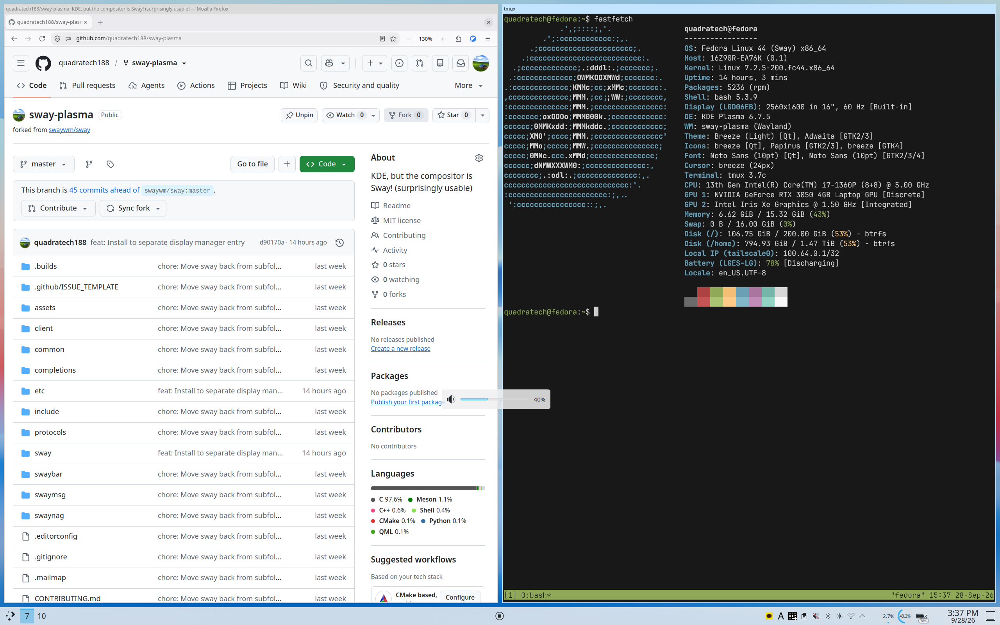

# `sway-plasma`



## What's here
- A partial implementation of KDE's [plasma-shell](https://wayland.app/protocols/kde-plasma-shell) wayland protocol in sway
    - `set_position` (Floats and correctly positions notifications, applets etc)
    - `set_role` (Correctly positions On-Screen Displays (volume / screen brightness etc))
    - `set_panel_takes_focus`

- Sway now emulates KWin's layers (Critical notifications show over fullscreen, etc)
- Sway's resize behavior was changed so that edges not being dragged don't lag
- Miscellaneous scripts that adds this setup as a login manager entry
- An `sway-extensions` executable that provides Kwin's:
    - `org.freedesktop.ScreenSaver` interface, which lets applications inhibit screen dimming
- A Sway workspace indicator widget & mode indicator widget

Everything that is not the compositor lives in `./etc/`.

## Usage
```
meson setup builddir .
meson compile -C builddir
sudo meson install -C builddir

cd etc
cmake -S . -B build -G Ninja
cmake --build build
sudo cmake --install build
```

> [!NOTE]
> This project was forked after sway bumped its required `wlroots` version to 0.21. Most distributions still ship 0.20.
> - Clone the `wlroots` repo inside `./subprojects/`.
> - `meson`'s default library install directory (`/usr/local/lib64/`) may not exist in `ld`'s search path. Add an entry in `/etc/ld.so.conf.d/` if this is the case.
