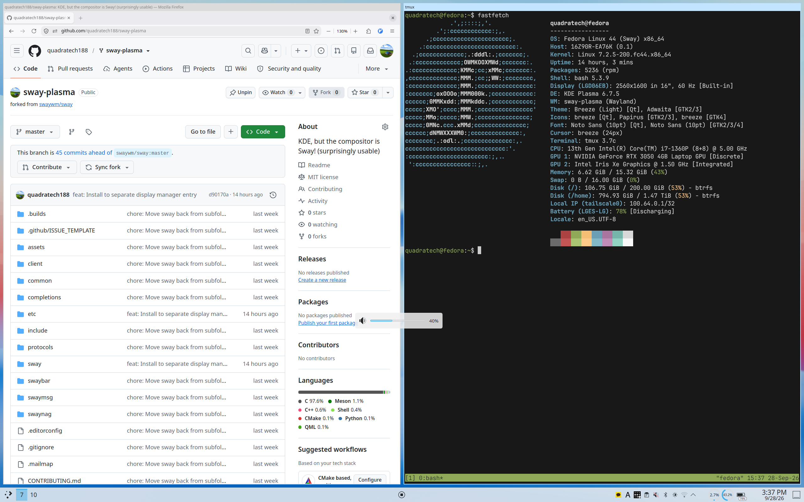

# `sway-plasma`



## What's here
- A partial implementation of KDE's [plasma-shell](https://wayland.app/protocols/kde-plasma-shell) wayland protocol in sway
    - `set_position` (Floats and correctly positions notifications, applets etc)
    - `set_role` (Correctly positions On-Screen Displays (volume / screen brightness etc))
    - `set_panel_takes_focus`

- Sway now emulates KWin's layers (Critical notifications show over fullscreen, etc)
- Sway's resize behavior was changed so that edges not being dragged don't lag
- Miscellaneous scripts that adds this setup as a login manager entry
- An `sway-extensions` executable that provides Kwin's:
    - `org.freedesktop.ScreenSaver` interface, which lets applications inhibit screen dimming
- A Sway workspace indicator widget & mode indicator widget

Everything that is not the compositor lives in `./etc/`.

## Installation

### Fedora COPR
https://copr.fedorainfracloud.org/coprs/quadratech188/sway-plasma/

### From Source
```bash
# Sway requires wlroots 0.21-dev, your distro probably doesn't ship it.
# We'll download it as a subproject instead.
meson setup builddir . \
    --wrap-mode=nofallback \
    --force-fallback-for=wlroots

meson compile -C builddir
sudo meson install -C builddir --skip-subprojects

cd etc
cmake -S . -B build -G Ninja
cmake --build build
sudo cmake --install build
```

Select 'Sway Plasma' from your display manager.
Copy the configuration file from `/usr/local/etc/sway-plasma` to `~/.config/sway-plasma` to make changes.
